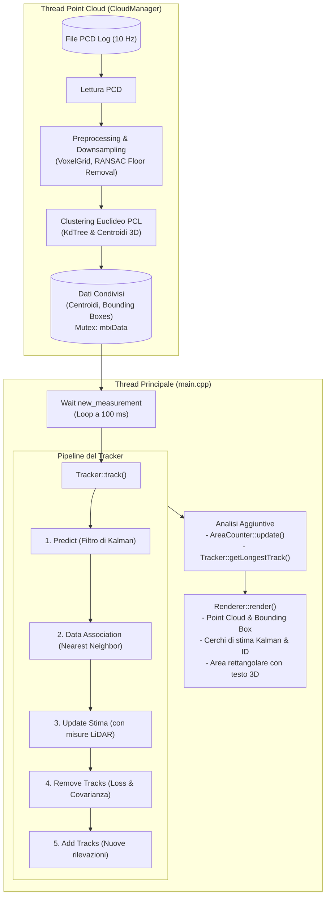
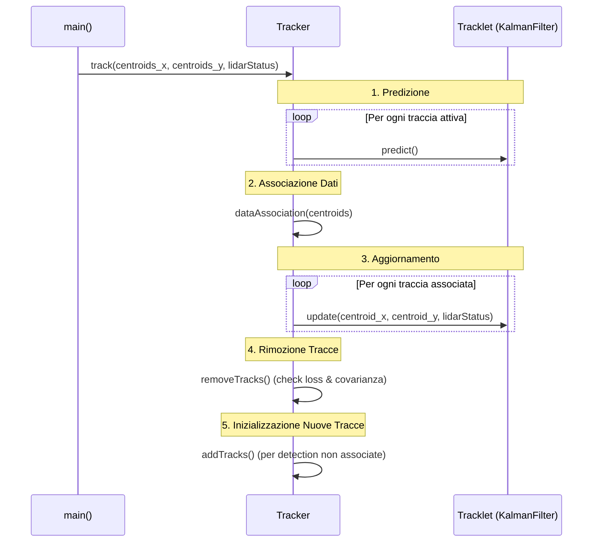

# Multi-Object Tracking di Pedoni con Filtro di Kalman e LiDAR 3D

Progetto di Multi-Object Tracking (MOT) in ambiente 3D basato su sensore LiDAR per il rilevamento e l'inseguimento in tempo reale di pedoni. Il sistema combina algoritmi di clustering su nuvole di punti (Point Cloud), stima dello stato cinematico tramite **Filtro di Kalman** 2D (a velocità costante), associazione dati robusta e funzionalità avanzate di analisi spaziale e comportamentale.

---

## Indice
1. [Architettura del Software](#1-architettura-del-software)
2. [Approfondimento: Classe KalmanFilter](#2-approfondimento-classe-kalmanfilter)
3. [Approfondimento: Classe Tracker e Tracklet](#3-approfondimento-classe-tracker-e-tracklet)
4. [Funzionalità Aggiuntive Implementate](#4-funzionalità-aggiuntive-implementate)
   - [Traccia con il percorso più lungo](#41-traccia-con-il-percorso-più-lungo)
   - [Area di monitoraggio e conteggio persone](#42-area-di-monitoraggio-e-conteggio-persone)
5. [Studio Sperimentale sulle Covarianze](#5-studio-sperimentale-sulle-covarianze)
   - [Caso 1: $Q \gg R$ (Sovraffidamento del Sensore)](#51-caso-1-q-gg-r-sovraffidamento-del-sensore)
   - [Caso 2: $R \gg Q$ (Eccessiva Fiducia nel Modello Cinematico - Lag)](#52-caso-2-r-gg-q-eccessiva-fiducia-nel-modello-cinematico---lag)
   - [Caso 3: Dropout del Sensore LiDAR](#53-caso-3-dropout-del-sensore-lidar)
   - [Tabella di Confronto delle Covarianze](#54-tabella-riassuntiva-dei-test)
6. [Guida alla Compilazione ed Esecuzione](#6-guida-alla-compilazione-ed-esecuzione)

---

## 1. Architettura del Software

Il sistema adotta un'architettura **multithread disaccoppiata**, separando le operazioni ad alta intensità di calcolo della Point Cloud dalla logica di tracking e dal rendering grafico interattivo.



### Componenti Principali:
1. **[CloudManager](file:///home/ilpiova/Autonomous/assignment/assignment_2/assignment_2/include/CloudManager.h)**:
   - Viene eseguito in un thread dedicato (`std::thread t(&CloudManager::startCloudManager, &lidar_cloud)`).
   - Itera sequenzialmente sui file binari `.pcd` a frequenza fissa ($10\text{ Hz} \rightarrow 100\text{ ms}$).
   - Esegue il filtraggio della nuvola (Voxel Grid downsampling, rimozione del piano stradale tramite RANSAC segmentation) e l'estrazione dei cluster di pedoni tramite `pcl::EuclideanClusterExtraction`.
   - Calcola i centroidi $(x, y, z)$ e i relativi bounding box, notificando il thread principale con il flag `new_measurement = true` protetto da mutex `mtxData`.
2. **[Tracker](file:///home/ilpiova/Autonomous/assignment/assignment_2/assignment_2/include/tracker/Tracker.h)**:
   - Riceve le coordinate 2D dei centroidi rilevati al frame corrente e gestisce il ciclo di vita delle tracce (*Tracklet*).
3. **[AreaCounter](file:///home/ilpiova/Autonomous/assignment/assignment_2/assignment_2/include/AreaCounter.h)**:
   - Monitora una regione poligonale 2D nello spazio e tiene traccia in modo univoco dei pedoni che la attraversano.
4. **[Renderer](file:///home/ilpiova/Autonomous/assignment/assignment_2/assignment_2/include/viewer/Renderer.h)**:
   - Incapsula `pcl::visualization::PCLVisualizer`.
   - Renderizza la point cloud colorata, i bounding box dei cluster, le circonferenze di stima del Filtro di Kalman con ID, e l'area delimitata con statistiche 3D.
   - Gestisce gli eventi di tastiera (callback interattiva: tasto `v` per simulare l'attivazione/disattivazione delle misure LiDAR).

---

## 2. Approfondimento: Classe KalmanFilter

La classe **[`KalmanFilter`](file:///home/ilpiova/Autonomous/assignment/assignment_2/assignment_2/include/tracker/KalmanFilter.h)** modella la dinamica del pedone sul piano orizzontale $(x, y)$ attraverso un modello cinematico a **Velocità Costante (Constant Velocity - CV)**.

### Definizione dello Stato e delle Misure
* **Vettore di stato** ($4\text{D}$):
  $$x = \begin{bmatrix} p_x \\ p_y \\ v_x \\ v_y \end{bmatrix}$$
  dove $(p_x, p_y)$ indicano la posizione stimata e $(v_x, v_y)$ le velocità lineari lungo gli assi cartesiani.
* **Vettore di misura** ($2\text{D}$):
  $$z = \begin{bmatrix} z_x \\ z_y \end{bmatrix}$$
  rappresenta la coordinata 2D del centroide del cluster LiDAR.

### Matrici del Filtro
1. **Matrice di transizione di stato ($F$)**:
   Con passo di campionamento $\Delta t = 0.1\text{ s}$:
   $$F = \begin{bmatrix} 1 & 0 & \Delta t & 0 \\ 0 & 1 & 0 & \Delta t \\ 0 & 0 & 1 & 0 \\ 0 & 0 & 0 & 1 \end{bmatrix}$$

2. **Matrice di osservazione ($H$)**:
   Estrae esclusivamente la posizione dallo stato:
   $$H = \begin{bmatrix} 1 & 0 & 0 & 0 \\ 0 & 1 & 0 & 0 \end{bmatrix}$$

3. **Matrice di covarianza dell'incertezza dello stato ($P$)**:
   Inizializzata in `init()` con valori elevati per riflettere l'incertezza iniziale a priori (in particolare per le velocità non misurate direttamente):
   $$P = \begin{bmatrix} 9999 & 0 & 0 & 0 \\ 0 & 9999 & 0 & 0 \\ 0 & 0 & 9999 & 0 \\ 0 & 0 & 0 & 9999 \end{bmatrix}$$

4. **Matrice di covarianza del rumore di processo ($Q$)**:
   Derivata integrando un modello di accelerazione stocastica continua (rumore bianco di accelerazione) con deviazione standard $\sigma_{ax} = \sigma_{ay} = \sqrt{2.0}\text{ m/s}^2$:
   $$Q = \begin{bmatrix} \frac{\Delta t^4}{4}\sigma_{ax}^2 & 0 & \frac{\Delta t^3}{2}\sigma_{ax}^2 & 0 \\ 0 & \frac{\Delta t^4}{4}\sigma_{ay}^2 & 0 & \frac{\Delta t^3}{2}\sigma_{ay}^2 \\ \frac{\Delta t^3}{2}\sigma_{ax}^2 & 0 & \Delta t^2 \sigma_{ax}^2 & 0 \\ 0 & \frac{\Delta t^3}{2}\sigma_{ay}^2 & 0 & \Delta t^2 \sigma_{ay}^2 \end{bmatrix}$$

5. **Matrice di covarianza del rumore di misura ($R$)**:
   Rappresenta l'accuratezza del sensore LiDAR nel rilevare i centroidi:
   $$R = \begin{bmatrix} \sigma_r^2 & 0 \\ 0 & \sigma_r^2 \end{bmatrix} = \begin{bmatrix} 0.0225 & 0 \\ 0 & 0.0225 \end{bmatrix} \implies \sigma_r = 0.15\text{ m}$$

### Fasi Operative
* **Fase di Predizione (`predict()`)**:
  Proietta in avanti lo stato e l'incertezza secondo il modello cinematico:
  $$x_{k|k-1} = F x_{k-1|k-1}$$
  $$P_{k|k-1} = F P_{k-1|k-1} F^T + Q$$

* **Fase di Aggiornamento (`update(const Eigen::VectorXd &z)`)**:
  Corregge la stima a priori incorporando l'osservazione LiDAR:
  $$y = z - H x_{k|k-1} \quad \text{(Innovazione o residuo di misura)}$$
  $$S = H P_{k|k-1} H^T + R \quad \text{(Covarianza dell'innovazione)}$$
  $$K = P_{k|k-1} H^T S^{-1} \quad \text{(Guadagno di Kalman)}$$
  $$x_{k|k} = x_{k|k-1} + K y \quad \text{(Stato aggiornato)}$$
  $$P_{k|k} = (I - K H) P_{k|k-1} \quad \text{(Covarianza aggiornata)}$$

---

## 3. Approfondimento: Classe Tracker e Tracklet

Il modulo di tracking è costituito dalla combinazione di due classi:
- **[`Tracklet`](file:///home/ilpiova/Autonomous/assignment/assignment_2/assignment_2/include/tracker/Tracklet.h)**: rappresenta una singola entità monitorata.
- **[`Tracker`](file:///home/ilpiova/Autonomous/assignment/assignment_2/assignment_2/include/tracker/Tracker.h)**: coordina l'insieme di tutti i tracklet e gestisce la logica MOT.

### 1. La classe `Tracklet`
Ogni tracklet incapsula:
- Un'istanza dedicata di `KalmanFilter`.
- Un identificativo univoco (`id_`).
- Il contatore dei frame di assenza di misure (`loss_count_`).
- Lo storico dei punti stimati (`trajectory_`), aggiornato ad ogni frame con misura valida.

I metodi principali:
- `predict()`: invoca la predizione del Kalman Filter e incrementa `loss_count_++`.
- `update(x, y, lidarStatus)`: se il LiDAR è attivo (`lidarStatus == true`), esegue la correzione del Kalman Filter con le coordinate $(x, y)$, memorizza la stima in `trajectory_` e azzera il contatore (`loss_count_ = 0`).

### 2. La classe `Tracker`
Il metodo `Tracker::track(centroids_x, centroids_y, lidarStatus)` orchestra il ciclo completo di tracciamento suddiviso in 5 passi:



1. **Predizione (`tracks_[i].predict()`)**:
   Tutte le tracce propagano la propria traiettoria al frame successivo in base alla velocità stimata.
2. **Associazione Dati (`dataAssociation`)**:
   Implementa un algoritmo **Nearest Neighbor**:
   - Calcola la distanza euclidea tra la predizione della traccia $(\hat{x}_i, \hat{y}_i)$ e tutti i centroidi non ancora associati al frame corrente $(c_{x,j}, c_{y,j})$.
   - Se la distanza minima è inferiore alla soglia `distance_threshold_ = 1.0 m`, la coppia viene inserita in `associated_track_det_ids_` e il centroide viene contrassegnato come occupato (`associated_detections[j] = true`) per impedire assegnazioni multiple.
   > [!NOTE]
   > All'interno di `Tracker.cpp` è predisposta e documentata anche l'implementazione basata sulla **Distanza di Mahalanobis**:
   > $$D_M = \sqrt{(z - H\hat{x})^T S^{-1} (z - H\hat{x})}$$
   > che tiene conto ellissoidale dell'incertezza $S = H P H^T + R$ con gating Chi-quadro ($\chi^2$).
3. **Aggiornamento Tracce**:
   Per ogni coppia associata `(det_id, track_id)` viene invocato `tracks_[track_id].update(...)`.
4. **Rimozione Tracce Obsolete (`removeTracks`)**:
   Una traccia viene eliminata se viola almeno uno dei seguenti criteri:
   - **Criterio temporale**: non riceve misurazioni per troppi frame consecutivi (`loss_count_ >= loss_threshold`, con soglia = $5$).
   - **Criterio di incertezza (covarianza)**: la covarianza sulla posizione $P_{xx}$ o $P_{yy}$ supera il limite di tolleranza (`covariance_threshold = 5.0 m^2`).
5. **Creazione Nuove Tracce (`addTracks`)**:
   I centroidi rimasti non associati vengono inizializzati come nuovi tracklet con ID incrementale univoco (`cur_id_++`).

---

## 4. Funzionalità Aggiuntive Implementate

### 4.1. Traccia con il percorso più lungo
*Requisito: "Return the id and length of the path of the track that has traveled the longest path"*

#### Logica e Modifiche al Codice:
1. **Filtraggio del rumore e stima della distanza in [`Tracklet.cpp`](file:///home/ilpiova/Autonomous/assignment/assignment_2/assignment_2/src/tracker/Tracklet.cpp)**:
   Per evitare che il rumore di misura del LiDAR o il jitter da fermo accumuli falsi metri di spostamento, è stata implementata una soglia minima di spostamento euclideo (`min_movement_threshold = 0.15 m`):
   ```cpp
   double Tracklet::getPathLength() const {
       if (trajectory_.size() < 2) return 0.0;
       double total_length = 0.0;
       const double min_movement_threshold = 0.15; // 15 cm
       Eigen::Vector2d last_valid_point = trajectory_[0];

       for (size_t i = 1; i < trajectory_.size(); ++i) {
           double step_distance = (trajectory_[i] - last_valid_point).norm();
           if (step_distance >= min_movement_threshold) {
               total_length += step_distance;
               last_valid_point = trajectory_[i];
           }
       }
       return total_length;
   }
   ```
2. **Selezione globale in [`Tracker.cpp`](file:///home/ilpiova/Autonomous/assignment/assignment_2/assignment_2/src/tracker/Tracker.cpp)**:
   Il metodo `Tracker::getLongestTrack()` interroga tutti i tracklet attivi ed estrae la coppia `<ID, lunghezza_massima>`:
   ```cpp
   std::pair<int, double> Tracker::getLongestTrack() const {
       int best_id = -1;
       double max_length = -1.0;
       for (const auto& track : tracks_) {
           double len = track.getPathLength();
           if (len > max_length) {
               max_length = len;
               best_id = track.getId();
           }
       }
       return (best_id == -1) ? std::make_pair(-1, 0.0) : std::make_pair(best_id, max_length);
   }
   ```
3. **Stampa a terminale nel `main.cpp`**:
   Ad ogni iterazione viene stampato lo stato corrente:
   ```bash
   Track con percorso piu' lungo:
     - ID: 1
     - Lunghezza: 3.42 m
   ```

---

### 4.2. Area di monitoraggio e conteggio persone
*Requisito: "Define an area and count the persons that has entered in that area"*

#### Logica e Modifiche al Codice:
1. **Creazione della classe [`AreaCounter`](file:///home/ilpiova/Autonomous/assignment/assignment_2/assignment_2/include/AreaCounter.h)**:
   Definisce un bounding box rettangolare sul piano cartesiano: $x \in [x_{min}, x_{max}]$, $y \in [y_{min}, y_{max}]$.
   Mantiene due contenitori basati su `std::set<int>`:
   - `current_inside_ids_`: memorizza gli ID presenti nell'area al frame attuale.
   - `entered_ids_`: memorizza tutti gli ID unici transitati almeno una volta nell'area.
   
   ```cpp
   void AreaCounter::update(const std::vector<Tracklet> &tracks) {
       current_inside_ids_.clear();
       for (const auto &track : tracks) {
           if (isInside(track.getX(), track.getY())) {
               current_inside_ids_.insert(track.getId());
               entered_ids_.insert(track.getId()); // Inserimento univoco (senza duplicati)
           }
       }
   }
   ```
2. **Estensione del [`Renderer`](file:///home/ilpiova/Autonomous/assignment/assignment_2/assignment_2/src/viewer/Renderer.cpp)**:
   Aggiunta della funzione `renderArea(...)` che visualizza il perimetro rettangolare dell'area con 4 linee 3D e stampa un testo 3D al centro dell'area contenente il conteggio delle persone presenti in tempo reale:
   ```cpp
   void Renderer::renderArea(double x_min, double x_max, double y_min, double y_max, int count, ...);
   ```
3. **Integrazione nel `main.cpp`**:
   L'area è configurata con estremi $x \in [-3.0, 3.0]\text{ m}$ e $y \in [-2.0, 2.0]\text{ m}$. A terminale e a video vengono mostrati sia i pedoni totali transitati sia gli occupanti attuali:
   ```bash
   Persone entrate nell'area: 3 (attualmente dentro: 1)
   ```

---

## 5. Studio Sperimentale sulle Covarianze

Il bilanciamento tra la matrice di covarianza del rumore di processo $Q$ e la matrice di covarianza del rumore di misura $R$ determina il **guadagno di Kalman**:
$$K = P H^T (H P H^T + R)^{-1}$$
Il guadagno $K$ agisce come fattore di peso ponderato tra la cinematica predetta dal modello matematico e l'osservazione geometrica restituita dal LiDAR. Di seguito vengono riportati i test condotti analizzando in particolare il **Cluster 1** (il target con la traiettoria più persistente nella scena).

---

### 5.1. Caso 1: $Q \gg R$ (Sovraffidamento del Sensore)
* **Configurazione parametri**:
  - Varianza di misura del sensore: $R = \mathrm{diag}(0.001, 0.001)\text{ m}^2 \implies \sigma_r \approx 0.0316\text{ m}$ (alta affidabilità del sensore).
  - Process noise nominale: $\sigma_{ax} = \sigma_{ay} = \sqrt{2.0}\text{ m/s}^2$.
* **Osservazioni ed Evidenze Sperimentali**:
  - Non si riscontra alcuna discrepanza o distorsione visibile nel tracking.
  - La posizione stimata dal cerchio del Kalman Filter racchiude e segue istantaneamente la nuvola di punti del Cluster 1 in tutte le fasi di moto.
* **Conclusioni**:
  - Le coordinate estratte dal clustering LiDAR presentano già intrinsecamente un'eccellente accuratezza geometrica. Di conseguenza, forzare il filtro a fare massimo affidamento sulle misurazioni $z$ non introduce instabilità o oscillazioni numeriche significative, confermando l'alta qualità del segnale LiDAR.

---

### 5.2. Caso 2: $R \gg Q$ (Eccessiva Fiducia nel Modello Cinematico - Lag)
* **Configurazione parametri**:
  - Varianza di misura del sensore elevata: $R = \mathrm{diag}(0.5, 0.5)\text{ m}^2 \implies \sigma_r \approx 0.7071\text{ m}$ (sensore considerato rumoroso e inaffidabile).
  - Process noise fortemente ridotto: $\sigma_{ax} = \sigma_{ay} = \sqrt{0.05}\text{ m/s}^2$ (modello forzato ad assumere velocità rigorosamente costante).
* **Osservazioni ed Evidenze Sperimentali**:
  - Si manifesta in modo netto ed evidente un **fenomeno di ritardo (Lag cinetico)**.
  - Durante le transizioni di moto e le accelerazioni del pedone (Cluster 1), la circonferenza che descrive la stima del Kalman Filter rimane indietro rispetto al centro effettivo del cluster.
  - Solo quando il pedone rallenta o si arresta, il filtro riesce progressivamente a recuperare l'errore e a riallinearsi sulla posizione stazionaria.
* **Conclusioni**:
  - Ponendo $R \gg Q$, il guadagno di Kalman $K$ collassa a valori prossimi allo zero ($K \to 0$). Il filtro rigetta le novità introdotte dalle misure $z$ e accorda priorità all'inerzia del modello cinematico. In presenza di manovre, cambi di passo o curve, il modello a velocità costante non è in grado di adattarsi tempestivamente, accumulando un errore di ritardo.

---

### 5.3. Caso 3: Dropout del Sensore LiDAR
* **Configurazione ed Esperimento**:
  - Pressione del tasto **`v`** durante l'esecuzione: disattivazione completa dell'aggiornamento LiDAR (`lidarStatus = false`).
* **Osservazioni ed Evidenze Sperimentali**:
  - Il filtro esegue iterativamente solo il passo di predizione:
    $$P_{k|k-1} = F P_{k-1|k-1} F^T + Q$$
  - In assenza del passo di correzione (che tramite $P = (I - KH)P$ contrae l'incertezza), la matrice di covarianza $P$ cresce a ogni ciclo per via della somma continua di $Q$.
  - Nel giro di pochissimi frame consecutivi, gli elementi diagonali superano la soglia critica impostata (`covariance_threshold = 5.0`).
  - Contestualmente, il contatore dei frame persi supera `loss_threshold = 5`. La funzione `removeTracks()` interviene ed elimina i tracklet dalla scena.
* **Conclusioni**:
  - Il meccanismo di rimozione basato su duplice soglia (temporale e di covarianza) impedisce efficacemente la proliferazione di tracce fantasma (*ghost tracks*), garantendo la sicurezza del sistema in scenari di occlusione prolungata o guasto del sensore.

---

### 5.4. Tabella Riassuntiva dei Test

| Scenario | Parametri di Covarianza | Guadagno di Kalman ($K$) | Comportamento Visivo | Valutazione / Robustezza |
| :--- | :--- | :--- | :--- | :--- |
| **Nominale** | $R = 0.0225\text{ m}^2$, $Q \sim \sigma_a^2 = 2.0$ | Bilanciato ($K \approx 0.5 - 0.7$) | Inseguimento fluido e centrato su tutti i pedoni | Ottimo compromesso dinamico/filtro rumore. |
| **$Q \gg R$ (Overfitting sensore)** | $R = 0.001\text{ m}^2$, $Q \sim \sigma_a^2 = 2.0$ | Elevato ($K \to 1$) | Nessuna alterazione visibile sul Cluster 1 | Tracking reattivo, ottimo grazie all'alta precisione LiDAR. |
| **$R \gg Q$ (Eccessiva fiducia nel modello)**| $R = 0.5\text{ m}^2$, $Q \sim \sigma_a^2 = 0.05$ | Molto basso ($K \to 0$) | Marcato **Lag cinetico** durante gli spostamenti | Reattività compromessa; la predizione non segue le accelerazioni. |
| **Dropout Sensore (Tasto `v`)** | Nessun update ($R \to \infty$) | Nullo ($K = 0$) | Crescita rapida dell'incertezza $P$ e scomparsa tracce | Comportamento corretto di fail-safe: rimozione delle tracce non supportate da misure. |

---

## 6. Guida alla Compilazione ed Esecuzione

### Requisiti di Sistema e Dipendenze
- **Sistema Operativo**: Linux (Ubuntu 20.04 / 22.04 o distribuzioni compatibili)
- **Compilatore C++**: compatibile con lo standard **C++17** (GCC / Clang)
- **CMake**: versione $\ge 3.5$
- **Librerie richieste**:
  - `PCL (Point Cloud Library)` $\ge 1.2$ (con visualizer e VTK)
  - `Eigen3`
  - `Boost` (filesystem, system)
  - `MPI` e `pthread`

Su distribuzioni basate su Debian/Ubuntu, installare le dipendenze con:
```bash
sudo apt-get update
sudo apt-get install -y build-essential cmake libpcl-dev libeigen3-dev libboost-all-dev libopenmpi-dev
```

---

### Configurazione del Dataset
1. Scaricare il dataset delle nuvole di punti LiDAR da [questo link Google Drive](https://drive.google.com/file/d/1TWfV1odleih6d0SG7q2Sbs1jbZ4oSPkP/view?usp=share_link).
2. Estrarre la cartella denominata `log` contenente i file sequenziali `.pcd`.
3. Posizionare la cartella `log` all'interno della cartella di compilazione `build/` (oppure aggiornare la variabile `log_path` in `demo/main.cpp` con il percorso assoluto desiderato).

---

### Procedura di Compilazione

Dalla radice del repository:
```bash
# 1. Creazione e accesso alla directory di build
mkdir -p build && cd build

# 2. Configurazione con CMake
cmake ..

# 3. Compilazione del progetto
make -j$(nproc)
```

La compilazione genererà:
- La libreria condivisa `libtracker.so`
- L'eseguibile `main`

---

### Esecuzione del Programma

Rimanendo all'interno della cartella `build/`:
```bash
./main
```

### Controlli da Tastiera e Interazione Visualizzatore:
- **`v`**: Attiva o disattiva l'acquisizione delle misure del sensore LiDAR (permette di validare il comportamento del solo modello di predizione e testare la risposta al dropout).
- **Mouse**:
  - *Tasto sinistro + trascinamento*: rotazione della telecamera 3D.
  - *Tasto destro + trascinamento / Rotella*: zoom in / zoom out.
  - *Tasto centrale + trascinamento*: traslazione (pan) della visuale.
